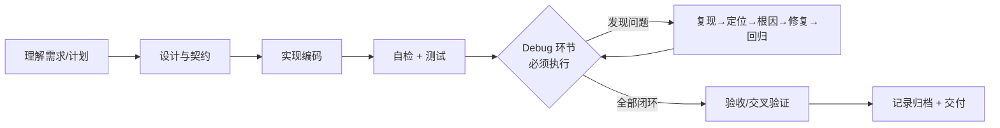

# System for future ai — 开发与 Debug 流程规范

**文档版本:** v1.0
**日期:** 2026-11-16
**适用范围:** 本项目（`sai` / `system-for-future-ai`）的全部开发活动，包括人工开发与 AI agent 驱动的开发会话
**关联文档:** [System_for_future_ai_Development_Plan_v0.5.md](System_for_future_ai_Development_Plan_v0.5.md)（工程开发计划，以下简称"开发计划"）

---

## 0. 强制性声明（核心规则，不可协商）

> **任何开发工作完成后，必须进行 Debug 环节。这是不可跳过的强制步骤。**

三条铁律：

1. **开发完成 ≠ 任务完成。** 功能/模块只有在通过 Debug 环节后才算完成（Definition of Done 的组成部分）。
2. **Debug 必须闭环。** 每个发现的问题要么被修复并通过回归验证，要么作为 known issue 显式登记（含影响范围、后续处理计划与 issue ID），不允许悬空。
3. **Debug 必须留痕。** Debug 环节的执行过程与结论必须写入本文档 §6 模板格式的 Debug 记录并归档，无记录视为未执行。

**禁止事项：**

- 未经 Debug 环节的功能，不得标记为"完成"、不得进入下一里程碑、不得对外交付或演示。
- 不得以"测试通过"为由跳过 Debug 环节（测试通过只是 Debug 的入口条件之一）。
- 不得在 Debug 发现问题后绕过架构原则做临时修补（对照开发计划 §0 的 Non-negotiable architectural principles）。
- 不得静默完成：接受标准未经独立验证不得宣告成功（对应开发计划 §8 "No silent completion"）。

---

## 1. 项目开发内容理解（摘要）

本节记录对开发计划 v0.5 的理解，作为 Debug 环节中"对照预期行为定位根因"的依据。

### 1.1 目标与交付物

构建一个**通用的、模型原生（model-native）的 Agent 平台**：由主模型自行选择下一步动作、能力、Skill 与信息访问方式，运行时不强加 Planner → Executor → Reviewer 工作流。两个主要交付物：

1. 一个可用的通用 Agent 系统（实际产品：持久会话、UI、凭据、取消、恢复、产物、权限）。
2. 一个可复现的研究代码库，能够支撑顶会论文（稀疏上下文激活 / 自路由研究）。

### 1.2 核心差异化

- **率先实现：Index-native context（索引原生上下文）** —— 模型维护有界的运行状态与一组信息地址（ref），仅在需要时检索原文证据、历史工具输出、Skill 指令或任务知识。
- **科学研究：** 模型原生路由与上下文激活（尤其是二者的联合选择）是否比独立选择、全量上下文或传统压缩方案获得更好的成功率–成本权衡。

### 1.3 非negotiable 架构原则（Debug 时不得违背的修复边界）

1. 单一主决策模型，无强制外部 LLM 路由器。
2. 工具（Tool）、能力（Capability）、Skill、模型（Model）是不同对象，不把任务类别硬编码进控制循环。
3. 自路由是真实的：模型可直接回答、发现能力、加载 Skill、检索上下文、执行、请求授权、验证或停止。
4. 禁止"纯索引失忆"：目标、硬约束、权限、关键任务状态与验收状态始终常驻（pinned），其余可按地址取用。
5. Wiki 是派生表示，不是事实来源；不可变事件记录与版本化原始工件始终可用。
6. 验证（Verification）是领域通用且独立于路由的；高风险/对外动作必须有运行时强制检查。
7. 度量所有成本（索引、Wiki 更新、检索、路由、验证、重试、缓存命中/未命中、工具、墙钟延迟）。
8. 构建真实产品，而非研究原型。

### 1.4 系统拓扑与六个逻辑平面

| 平面 | 组件 | 职责 |
|---|---|---|
| Model control | Provider adapters、决策内核、step loop | 选择下一个意图；报告不确定性；适时停止 |
| Capability & Skill | 注册表、发现、激活、Skill 包 | 让操作可发现而不加载全部 schema |
| Context intelligence | 索引、Wiki、编译器、检索器、working set | 保留证据的同时有界化模型可见上下文 |
| Execution runtime | Broker、环境适配、任务调度 | 执行被授权的操作并持久化结果 |
| **Verify & Debug** | 校验器、验收规则、诊断 | 验证声明、工件、代码、数据与外部效果 |
| Infrastructure | 事件存储、鉴权、密钥、指标、工件 | 完整性、恢复、隔离与可观测性 |

### 1.5 技术基线

Python 3.11+（async）、Pydantic v2 + JSON Schema、SQLite（WAL）+ SQLAlchemy + 本地 blob 存储、FTS5 + 图链接检索（v0）、FastAPI 流式 API、CLI 优先（`sfai run/resume/status/inspect/verify/export-trace`）、MCP client 适配器、Agent Skills 式 `SKILL.md` 包、JSONL 事件日志 + OpenTelemetry 兼容 span、`uv` + Docker、`pytest` 离线 fixture 与确定性回放（核心正确性测试不依赖在线 API）。

### 1.6 实施里程碑（M0–M8）

| 里程碑 | 内容 | Exit gate 要点 |
|---|---|---|
| M0 | 契约、环境、评测骨架 | 离线测试通过；事件可回放到相同任务状态 |
| M1 | 模型原生执行内核（垂直切片） | 真实模型完成 search→analysis→artifact 任务；简单问题零发现调用 |
| M2 | 事件账本、恢复、任务权威状态 | 中途 kill 后重启可恢复，无丢失约束/重复写入 |
| M3 | 上下文索引 v0（首个研究基线） | 长历史精确取回；早期硬约束保留；相对全量回放降低重复载荷 |
| M4 | 增量 Wiki 编译器与溯源 | 重复摄入不静默复制事实；编译失败不污染任务权威状态 |
| M5 | 动态能力与 Skill | 不改内核即可安装新能力；未用 Skill 指令绝不进入提示词 |
| M6 | 独立 Verify & Debug | 故意植入的错误（代码/引用/文档）被检出；失败产生可行动证据 |
| M7 | 产品化加固 | 其他开发者不改源码即可安装并完成多步任务 |
| M8 | 稀疏选择研究与受控消融 | 质量–成本–延迟曲线带置信区间；负结果保留 |

**关键路径：** M0 → M1 → M2 → M3 → M4；M5、M6 可在 M2 后并行；M7 集成；M8 在 M1/M3 可用后启动基线采集。另有 SF-001…SF-020 首批工程 issue、A–L 十二个真实场景验收项、双轨 Definition of Done（产品轨 + 研究轨）。

### 1.7 与 Debug 环节直接相关的系统设计

开发计划 §7 定义了 Independent Verify & Debug 子系统，含三种验证模式（**确定性**：schema/测试/文件/构建/哈希/状态码；**证据型**：声明与被引源文比对、时效性、冲突、捏造引用；**模型辅助**：仅在确定性标准不足时使用并标注不确定性），失败返回机器可读诊断（`verdict` / `error_code` / `evidence_refs` / `repair_hint` / `repair_safe_to_auto_run`）。**本规范的 Debug 环节与该子系统同构**：开发调试时使用同样的验证模式与诊断结构，开发出的系统本身也必须实现该子系统（M6）。

---

## 2. 开发总体流程（Debug 为必经阶段）

```text
需求/计划理解 → 设计与契约 → 实现编码 → 编码自检(lint/type) → 测试(单测/集成/契约/回放)
    → 【必须】Debug 环节（§3 六步闭环）
    → 交叉验证/验收（对照验收标准与 §12 场景）
    → 文档与 Debug 记录归档
    → 交付 / 进入下一里程碑
```



**流程规则：**

- 测试阶段发现的失败是 Debug 环节的**输入**，不是跳过 Debug 的理由。
- Debug 中修复的代码必须重新走"自检 + 测试"，形成循环直至闭环。
- 交付与里程碑流转是 Debug 的**下游**，顺序不可颠倒。

---

## 3. Debug 环节（强制阶段）执行规范

### 3.1 触发时机（以下情况必须执行）

1. 每个开发任务 / 功能 / 模块实现完成后。
2. 每个里程碑（M0–M8）的 exit gate 评估之前。
3. 每次对外交付、演示或发布之前。
4. 任何 bug 修复之后（修复本身也必须经过回归验证的 mini-debug 闭环）。
5. 跨模块契约（schema、接口、事件格式）变更之后。
6. 依赖升级、环境迁移或部署配置变更之后。

### 3.2 入口条件

- 本轮开发的代码已完成并可构建 / 可运行。
- lint / type check 已运行（结果是 Debug 的输入）。
- 常规测试已运行（允许存在失败——失败项即 Debug 待办清单）。
- 开发计划中对应模块的预期行为已明确（对照 §1 及开发计划原文）。

### 3.3 六步闭环（按序执行，不得省略）

| 步骤 | 名称 | 要求 |
|---|---|---|
| 1 | **复现 Reproduce** | 为每个问题建立确定性复现路径（最小复现命令 / 离线 fixture / trace 回放）。无法稳定复现的问题须记录复现条件与概率。 |
| 2 | **定位 Isolate** | 二分范围、日志与 JSONL 事件日志 / OTel span、最小化到具体模块或契约。区分症状与根因。 |
| 3 | **根因 Root-cause** | 说明"为什么会发生"，对照 §1 的架构原则与契约定义判定是实现错误、契约错误还是设计缺陷。 |
| 4 | **修复 Fix** | 最小化修复；不绕过架构原则；不引入新的静默成功；修复方案在 Debug 记录中说明理由。 |
| 5 | **回归 Regression** | 全量测试 + 相关 replay 套件；**每个修复新增至少一个防复发回归用例**；检查成本/性能无意外回退（tokens、延迟、工具调用计数）。 |
| 6 | **记录 Record** | 按 §6 模板填写 Debug 记录，归档到 `docs/debug-reports/`，并在里程碑/issue 中引用。 |

### 3.4 验证模式（与开发计划 §7 对齐）

- **确定性验证优先：** schema 校验、单测/集成测试、文件存在性与 MIME、语法/构建、哈希、状态码。
- **证据型验证：** 声明与源文比对、引用可解析性、时效性与冲突检查（尤其针对研究/文档类产出）。
- **模型辅助验证兜底：** 仅在确定性标准不足时使用，且不确定的判断必须显式标注为不确定。

### 3.5 失败诊断格式（统一留痕结构）

Debug 中的每个失败项按开发计划 §7 的诊断契约记录，便于后续机器处理与统计：

```json
{
  "verdict": "fail",
  "target_ref": "artifact://task_001/report.pdf@1",
  "criterion": "required_citations_resolve",
  "error_code": "BROKEN_CITATION_REF",
  "evidence_refs": ["source://task_001/page_17@2"],
  "repair_hint": "Rebuild citation mapping and rerun verification",
  "repair_safe_to_auto_run": true
}
```

**副作用铁律：** 重试/修复步骤的执行不得抹去已发生的不可逆动作状态；收据、审批、补偿动作与用户可见状态必须保留（对应开发计划 §7 Side-effect rule）。

---

## 4. Debug 完成判定（出口条件 / Checklist）

**全部满足才可宣告 Debug 环节结束；任一项不满足则回到 §3.3 对应步骤继续：**

- [ ] 所有已知问题已修复并通过回归，或作为 known issue 显式登记（含影响范围、后续 issue ID、负责人/计划）。
- [ ] 适用的全部测试通过（unit / contracts / integration / replay / security / e2e）。
- [ ] lint / type check 零新增告警。
- [ ] 每个修复都有对应回归用例，且失败可在修复前复现（防复发证明）。
- [ ] 无静默完成：所有验收标准经独立验证，而非仅凭模型自评或"看起来对"。
- [ ] 成本/性能无意外回退：trace 中 tokens、延迟、工具调用计数在预期范围内或差异有解释。
- [ ] Debug 记录（§6 模板）已填写并归档，判定为 PASS。
- [ ] 修复未违反 §1.3 架构原则（如涉及边界，已在 Debug 记录中论证）。

---

## 5. 与开发计划的集成

### 5.1 里程碑 Exit Gate 增补

开发计划 §10 规定"每个里程碑必须产出代码、测试、文档和可运行示例"。本规范增补：**每个里程碑必须通过 Debug 环节并留下记录，exit gate 方可签核。** 各里程碑的 Debug 重点：

| 里程碑 | Debug 重点 |
|---|---|
| M0 | 回放确定性（事件回放到相同状态）、fixture 稳定性 |
| M1 | 决策循环健壮性（直答路径零发现调用、工具失败路径） |
| M2 | 崩溃恢复：kill 后恢复无丢失约束、无重复已提交写入、无伪造动作状态 |
| M3 | 过期引用（stale ref）、上下文遗漏、约束丢失的检出与修复 |
| M4 | Wiki 写入损坏事实、重复事实、编译失败污染任务权威状态的排查 |
| M5 | 能力隔离：未激活 Skill 不进提示词、权限不被激活动作绕过 |
| M6 | Debug/验证子系统自身：故意植入错误是否被检出、诊断是否可行动 |
| M7 | 并发、超时/退避、恢复演练、ACL 泄漏路径 |
| M8 | 消融可复现性、指标统计口径、负结果记录完整性 |

### 5.2 Issue 完成定义

Tracker 中每个 issue 的 "Done when" 条件之外，附加统一完成定义：**"debug phase completed & recorded"（Debug 环节已执行且有记录）**。SF-001…SF-020 适用。

### 5.3 验收场景（开发计划 §12，A–L）

每个场景验收通过后仍需完成 Debug 环节留痕。其中 **I（意外工具失败）** 与 **J（崩溃/重启）** 本身即可靠性 Debug 场景，必须保留完整诊断记录；**K（提示注入）** 与 **L（多用户隔离）** 的任何失败按安全事件处理，修复后需专项回归。

---

## 6. Debug 记录模板

归档位置：`docs/debug-reports/<日期>-<里程碑或功能名>.md`

```markdown
# Debug Report — <里程碑 / 功能 / issue 范围>

- 日期：
- 开发者 / 会话：
- 关联 issue：SF-xxx
- 关联 milestone：Mx
- 判定：PASS / FAIL

## 1. 症状（Symptom）
现象、错误信息、影响范围。

## 2. 复现步骤（Reproduction）
最小复现命令 / fixture / trace 回放方式；复现条件与频率。

## 3. 根因（Root cause）
为什么会发生；定位证据（日志、事件、测试）；属于实现/契约/设计哪类问题。

## 4. 修复（Fix）
改动文件与方案；为何不违背架构原则；如涉及契约变更，注明同步更新的文档。

## 5. 回归验证（Regression）
执行的测试命令与结果；新增防复发用例（文件:用例名）；成本/性能对比。

## 6. 遗留项（Known issues / Remaining）
未修复项、影响、后续 issue ID、计划。无则写"无"。

## 7. 失败诊断（如有，按 §3.5 JSON 格式粘贴）
```

---

## 7. 强制性条款汇总

1. **开发完成后必须进行 Debug 环节** —— 不可跳过、不可合并进"开发"一步带过、不可事后补记。
2. Debug 六步闭环（复现→定位→根因→修复→回归→记录）按序执行，出口条件全满足才算结束。
3. Debug 记录必须归档；无记录 = 未执行 = 不得标记完成。
4. 里程碑 exit gate 与 issue 完成定义均包含 Debug 环节；交付与里程碑流转位于 Debug 下游。
5. Debug 修复不得违反开发计划 §0 架构原则；不得静默完成；不得抹去不可逆动作状态。
6. 本规范与开发计划 §7（Independent Verify & Debug）、§10（Exit Gates）、§12（Acceptance Suite）、§17（Definition of Done）同步维护；如有冲突，以更严格的一方为准。
