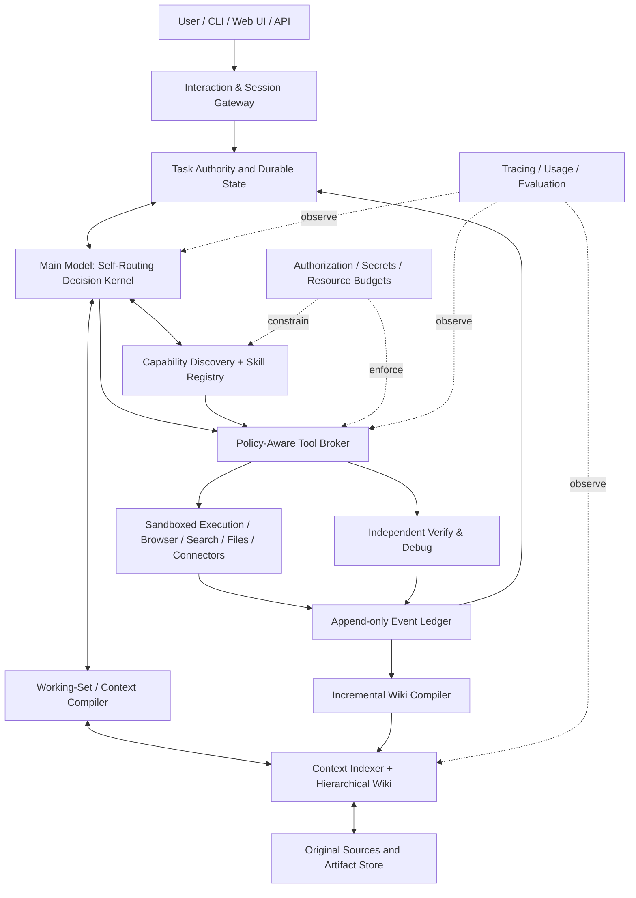
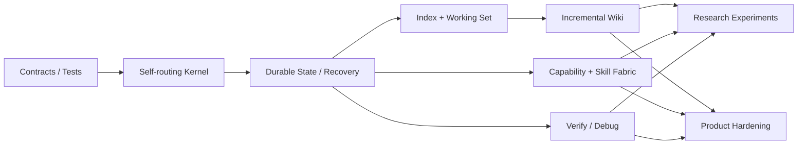

# System for future ai
## Engineering Development Plan — v0.5

**Date:** 2026-11-16  
**Status:** Implementation-ready development plan, with explicit research hypotheses  
**Language:** English  
**Supersedes:** The implementation sequencing in v0.4; does not replace the broader architecture or requirements documents  
**Primary deliverables:** (1) a usable general-purpose Agent system; (2) a reproducible research codebase capable of supporting a top-tier paper

---

## 0. Executive Decision

Build **a general-purpose, model-native Agent platform in which the main model chooses its next action, capability, Skill, and information access**. The runtime does not impose a Planner → Executor → Reviewer workflow. Instead, it provides a small set of stable operations, a discoverable capability ecosystem, a Wiki-derived addressable context system, execution infrastructure, and independent verification.

**Differentiator to implement first:** *Index-native context*. The model keeps a bounded operational state and a compact set of information addresses; it retrieves the original evidence, past tool output, Skill instructions, or task knowledge only when useful. **Differentiator to study scientifically:** whether *model-native routing and context activation*, especially their coordination, yield better end-to-end success–cost trade-offs than independent selection, full context, or conventional compaction.

### Non-negotiable architectural principles

1. **One primary decision model; no mandatory external LLM router.** Models can be swapped. Optional specialists are tools, not an architectural prerequisite.
2. **Tools, capabilities, Skills, and models are different objects.** Avoid hard-coding task categories into the control loop.
3. **Self-routing is genuine.** The model can answer directly, discover capabilities, load Skills, search context, execute, seek authorization, verify, or stop.
4. **No index-only amnesia.** Goal, hard constraints, permissions, essential task state, and failure/acceptance status remain pinned; the rest is addressable.
5. **The Wiki is a derived representation, not a source of truth.** Immutable event records and versioned original artifacts remain available.
6. **Verification is domain-general and independent of routing.** Runtime-enforced checks are required for high-risk or externally consequential actions.
7. **Measure all costs.** Include indexing, Wiki updates, retrieval, routing, verification, retries, cached/uncached inputs, tools, and wall-clock latency.
8. **Build an actual product.** Durable sessions, user interfaces, credentials, cancellation, recovery, artifacts, and permissions are not optional future research tasks.

### Explicitly out of scope for the first implementation

- Training an MoE backbone or modifying DeepSeek's internal attention kernels.
- Building a separate specialist LLM for each capability.
- A fixed task graph, compulsory chain-of-thought planning, or compulsory expert hand-offs.
- A distributed microservice architecture before single-process reliability is proven.
- An autonomous Skill marketplace that executes unreviewed third-party code.
- Claiming a new paper contribution from Wiki storage, MCP integration, or Skill loading alone.

---

## 1. Target System Topology



**Interpretation:** This is a *dependency map*, not a fixed workflow. A direct-answer task can bypass capability discovery, tool execution, Wiki reads, and verification when appropriate. A task with external side effects is subject to runtime policy regardless of what the model decides.

### Six logical planes — one deployable process initially

| Plane | Components | Primary responsibility |
|---|---|---|
| Model control | Provider adapters, decision kernel, step loop | Choose the next intent; report uncertainty; stop when done |
| Capability & Skill | Registry, discovery, activation, Skill packages | Make operations discoverable without loading all schemas |
| Context intelligence | Index, Wiki, compiler, retriever, working set | Preserve evidence while bounding model-visible context |
| Execution runtime | Broker, environment adapters, task scheduler | Carry out authorized operations with durable results |
| Verify & Debug | Validators, acceptance rules, diagnostics | Verify claims, artifacts, code, data and external effects |
| Infrastructure | Event store, auth, secrets, metrics, artifacts | Ensure integrity, recovery, isolation and observability |

---

## 2. Technology Baseline and Deployment Strategy

These choices are **engineering defaults**, not a restriction on the research hypothesis. All critical contracts remain language-agnostic.

| Concern | Initial choice | Rationale / later option |
|---|---|---|
| Core | Python 3.11+ with async support | Fast integration with model, retrieval and evaluation libraries |
| Models | Provider-neutral adapter using native function/tool calling | Support a hosted model and a local/OpenAI-compatible endpoint |
| Schemas | Pydantic v2 + JSON Schema | Runtime validation and portable tool contracts |
| Persistence | SQLite (WAL) + SQLAlchemy; local filesystem blob store | Low operational burden; PostgreSQL/object storage later |
| Retrieval v0 | SQLite FTS5 + explicit graph links + task/recency signals | Deterministic baseline; optional vectors later |
| Retrieval v1 | Optional embedding index (e.g. FAISS) plus reranking | Only if it improves end-to-end evaluation |
| API | FastAPI + streaming endpoints | CLI and UI can share the same task interfaces |
| Interface v0 | CLI with streaming traces and resumable task IDs | Fastest usable vertical slice |
| Interface v1 | Small web UI, task dashboard and artifact viewer | Product-level usability |
| Tool ecosystem | Native adapters + MCP client adapter | MCP for interoperability, not a substitute for authorization |
| Skills | Agent Skills-style `SKILL.md` package with manifest metadata | Progressive disclosure and portability |
| Tracing | JSONL event logs + OpenTelemetry-compatible spans | Reproducibility and operations |
| Packaging | `uv`, `pyproject.toml`, Docker for sandboxed execution | Reproducible environments |
| Tests | `pytest`, offline fixtures, deterministic replay | No reliance on live APIs for core correctness tests |

**Compatibility notes:** The published MCP specification version `2026-07-28` includes tool interfaces and authorization guidance; support it through a version-negotiating adapter rather than copying its wire protocol into the Agent core. The Agent Skills format uses name/description discovery and deferred instruction loading. OpenTelemetry GenAI semantic conventions are useful for tracing but remain an evolving specification.

---

## 3. Runtime Contracts: Implement These Before Features

### 3.1 Persistent entities

Every externally meaningful operation must be traceable to IDs:

| Entity | Required fields |
|---|---|
| `Task` | `task_id`, user/tenant, goal, constraints, acceptance rules, status, budget, version |
| `TaskState` | active stage/intent, completed outputs, unresolved errors, checkpoint, version |
| `Decision` | `decision_id`, task ID, model ID, input context hash, structured intent, cost/timing |
| `Event` | monotonic sequence, idempotency key, actor, event type, timestamp, structured payload |
| `Source` | immutable ID, origin, content hash, MIME type, owner/ACL, trust level, storage URI |
| `WikiNode` | stable node ID, type, title, summary, edges, source refs, revision, validity |
| `ContextRef` | `ref_id`, revision/snapshot, locator/range, token estimate, access scope |
| `Capability` | stable ID, description, prerequisites, operations, safety class, version |
| `Skill` | name, description, revision, entrypoint, references, compatibility, trust metadata |
| `ToolRun` | operation ID, args hash, status, result refs, environment, side effects, receipt |
| `Verification` | target, criteria, evidence refs, findings, verdict, diagnostic information |
| `Artifact` | stable ID, file path/URI, checksum, MIME type, version, provenance |

### 3.2 Model-visible minimal interface

Expose a compact, stable set of meta-operations rather than all installed tool schemas:

```text
capabilities.discover(query, limit, filters?)
capabilities.inspect(capability_ids)
capabilities.activate(capability_id, skill_ids?, scope?)
capabilities.invoke(capability_id, operation_id, arguments, idempotency_key?)
context.list(index_ref?, depth?, limit?)
context.search(query, scope?, filters?, limit?)
context.read(ref_id, range?, max_tokens?)
context.resolve(ref_ids, include_provenance=true)
verify.run(target_refs, criteria_ref?, mode?)
state.get(task_id, fields?)
state.checkpoint(note?, output_refs?)
```

**Important:** `context.read` returns a bounded excerpt with a stable reference and a path back to the original. `context.search` is only a hint, not a statement of truth. `capabilities.activate` loads Skill instructions or operation schemas *only into the relevant working set* and does not grant permission. Tool execution always re-checks policy.

**Implementation choice:** For model providers that do not support dynamically updated tool schemas mid-session, use a stable `capabilities.invoke` wrapper with validated nested arguments. Where native tool schema updates are supported, selectively expose activated operations for stronger validation. Measure both paths.

### 3.3 A single action-intent envelope

```json
{
  "kind": "discover|retrieve|activate|execute|verify|respond|ask_user|pause|finish",
  "task_id": "task_001",
  "reason_code": "information_needed",
  "payload": {},
  "expected_refs": [],
  "idempotency_key": "task_001:step_009"
}
```

`reason_code` is an auditable short label, **not a demand to emit private chain-of-thought**. The runtime validates an intent and returns structured tool outputs or errors. Provider-native function calls can be normalized into the same envelope.

### 3.4 Task status is not a predefined task workflow

`created → active → {waiting_approval, paused, blocked, completed, failed, cancelled}`

State transitions describe operational lifecycle only. The model can discover, retrieve, and execute in any useful order. Automatic retry is limited to operations known to be idempotent or explicitly deduplicated.

### 3.5 A bounded context envelope

```yaml
resident_context:
  goal: "Generate an evidence-backed report"
  pinned_constraints:
    - "Final output must be PDF"
    - "External sending requires approval"
  task_state:
    current_status: "Evidence review"
    last_material_result: "Sources indexed"
    open_failure: null
  root_index:
    task: "task://task_001/index@6"
    knowledge: "wiki://task_001/root@14"
    sources: "source://task_001/catalog@21"
    skills: "skill://registry/index@8"
  active_refs:
    - "wiki://task_001/methods#sparse-context@3"
  budget:
    active_context_tokens: 10000
    tool_calls_remaining: 20
```

These numerical budgets are **example configuration values**, not universal defaults. The framework must support different task types and model context capacities.

---

## 4. The Self-Routing Kernel

**Design rule:** The main model is the policy for choosing *which action to request*. The runtime is the authority for deciding whether and how that request is executed.

### Required behaviors

- Direct answer with **zero discovery calls** when tools are unnecessary.
- Discover and activate only the required capability/Skill; do not force an expert label on every message.
- Use arbitrary sequences and combinations of Web Search, Browser, Code, Data, Documents, Vision, external apps and Verify.
- Fetch context through indexed references rather than demanding complete history replay.
- Reuse already activated capabilities and current working-set information until a material change makes them irrelevant.
- Ask for approval before consequential actions; never infer permission from retrieved webpages or Skill instructions.
- Stop when acceptance criteria are met or report precisely what is incomplete.
- Detect loops and repetitive calls through runtime controls; the model does not need a separate planning subsystem to do so.

### Reference execution loop

```python
async def run_task(task_id: str):
    while True:
        state = await task_store.load(task_id)
        envelope = await context_compiler.build(state)
        response = await model.decide(envelope, minimal_tool_schema)
        await ledger.record_model_decision(task_id, response, envelope.hash)

        if response.kind in {"respond", "finish"}:
            assessment = await acceptance.evaluate_if_required(state, response)
            if assessment.blocks_completion:
                await task_store.record_open_issue(task_id, assessment)
                continue
            return await delivery.finalize(task_id, response)

        intent = intent_validator.parse(response)
        result = await policy_aware_dispatcher.execute(intent, state)
        await ledger.append_tool_result(task_id, intent, result)
        await task_store.apply_events(task_id, result.state_events)
        await wiki_compiler.enqueue_material_changes(task_id, result)
```

**Production conditions omitted from pseudocode:** cancellation, approval wait, provider streaming, rate-limit backoff, timeout, budgets, lease fencing, idempotent retries, crash recovery and concurrency control. These are addressed in Milestones A–D.

### Cost-control rules

- No model call merely to decide whether to call the same model again.
- Do not activate a Skill already resident unless its version changed.
- Cache capability discovery/inspection metadata under explicit validity and ACL rules.
- Return large tool outputs as short previews and persistent `ref_id`s, not as giant chat messages.
- Avoid repeated Wiki compilation for every small tool event; use material-change triggers.
- Use batching for independent reads when it genuinely reduces calls without hiding errors.
- Record true decision overhead, not just main-answer tokens.

---

## 5. Index-Native Context: Storage and Data Flow

### 5.1 Four storage strata

1. **Task Authority Store:** small, canonical mutable state: goal, constraints, approvals, acceptance, current status. This is never reconstructed only from Wiki summaries.
2. **Append-only Event Ledger + Original Source Store:** events, complete tool outputs, downloaded evidence, source files and immutable artifacts; content-addressed where practical.
3. **Compiled Wiki:** durable pages/nodes representing facts, task decisions, concepts, work products, cross-links and provenance; every derived statement points back to source refs.
4. **Index + Working Set:** hierarchical root/sub-index, FTS/graph/vector candidates, budget-aware selection, hot working-set cache; only this and pinned state appear in model prompts.

### 5.2 Wiki node types

`knowledge`, `task`, `constraint`, `decision`, `evidence`, `artifact`, `skill`, `execution_summary`, `failure`, `verification`.

Keep **typed edges**, e.g. `depends_on`, `requires`, `supersedes`, `supported_by`, `produced_by`, `contradicts`, `verified_by`, `relevant_to`.

### 5.3 Data creation sequence

```text
Tool action or user input
  -> event captured immediately
  -> raw payload stored with hash, owner and provenance
  -> critical task state updated synchronously
  -> lightweight search metadata appended
  -> material-change classifier schedules Wiki compilation
  -> compiler updates relevant nodes and edges with source references
  -> index revisions become queryable
  -> model retrieves on demand by search/list/read
```

**Correctness:** Never let asynchronously updating Wiki pages control authorization, completion state, or irreversible action decisions. A write to source/event store succeeds before a dependent derived update becomes visible. Preserve failed compilation events and retry them with idempotency keys.

### 5.4 How the model avoids knowing every address

The root index is deliberately small. It only exposes *entrypoints* (task, sources, knowledge, skills, artifacts), not the full Wiki tree. The model can browse `context.list` and search the index. A scoped short synopsis helps it recognize when relevant information exists. Support explicit reference pinning for user-stated constraints and high-risk dependencies.

### 5.5 Retrieval modes

- **Address lookup:** exact `ref_id` or link traversal.
- **Lexical search:** titles, keywords, IDs, filenames, code symbols, quoted passages.
- **Graph traversal:** related decisions, evidence, dependent tasks, citations and revisions.
- **Semantic search:** optional embeddings for uncertain phrasing and broad topical retrieval.
- **Temporal/state filters:** source validity, task phase, provenance, and last verified status.
- **Safety/ACL filtering:** apply *before* candidate ranking and before return.

### 5.6 Working-set selection

Candidate `c_i` is ranked with a baseline score:

```text
score(c_i) = lexical_match
           + semantic_match (if available)
           + task_state_match
           + active_capability_match
           + evidence_and_constraint_priority
           - redundancy_penalty
           - staleness_penalty
```

Then select a dependency-consistent set under a token budget. Return a **retrieval receipt**: selected refs, omitted candidates count, source revisions, estimated token cost, and why relevant in brief structured codes.

Start with a deterministic heuristic to establish a benchmark. Do **not** train a sparse indexer until the baseline retrieval, data collection, and missing-context tests work.

### 5.7 Failures to handle deliberately

| Risk | Required mitigation |
|---|---|
| Model does not know something should be retrieved | Pinned constraints, root index coverage, failure-triggered retrieval, regression tests |
| Context refers to the wrong version | Revision-bound refs, snapshot consistency, stale-ref resolution |
| Wiki writes corrupt established facts | Source links, contradiction edges, non-destructive versioning, disputed status |
| Context selection drops an essential dependency | Dependency-aware retrieval; mandatory constraints excluded from eviction |
| Retrieval becomes more expensive than full context | Cost metering and short-circuit policies; compare full-context fallback |
| Sensitive data appears through a cross-user index | Per-tenant ACL filters at source query, cache key and context assembly |
| Untrusted retrieved text instructs the agent to run tools | Treat sources as data; tool policy and task authority cannot be overridden |
| Large binary/multimodal content cannot be represented as text | Stable artifact refs, metadata and modality-specific readers, not lossy invented text |

---

## 6. Capability Fabric and Professional Skills

### Capability taxonomy: definitions, not hard-coded routing categories

- **Capability:** a discoverable family of useful operations, e.g. `web.research`, `browser.interaction`, `code.execution`, `document.production`, `data.analysis`, `vision`, `external_apps`, `verification`.
- **Tool:** a concrete invocable operation with a schema and side effects.
- **Skill:** reusable instruction/procedure/knowledge bundle, normally not executable by itself.
- **Environment:** sandbox/browser/process/remote service required to execute an operation.
- **Specialist model:** optional additional model chosen for a specific capability; not required.

### Minimal manifest

```yaml
id: web.research
version: "0.1.0"
description: "Find, open, and cite web evidence"
operations:
  - id: search
    input_schema: schemas/search.input.json
  - id: open
    input_schema: schemas/open.input.json
permissions:
  network: true
risk_class: read_only
output_contract:
  persistent_raw_output: true
  return_preview_and_ref: true
healthcheck: "health/web_research"
```

A Skill package:

```text
skills/
  academic-literature/
    SKILL.md
    manifest.yaml        # optional framework-specific metadata
    references/
    scripts/
    tests/
```

Skill discovery loads just `name`, `description`, eligibility and version. Activation loads the needed instruction sections and references; execution still takes place through the tool broker. Treat third-party Skill text as untrusted until explicitly installed/approved.

### First capability implementations

**Required breadth for first user-facing release:**

1. `web.research`: public search/open, result storage, citation/source tracking.
2. `browser.interaction`: navigate, inspect, click/type, screenshot, durable session.
3. `filesystem.artifacts`: read/write/convert/download output with provenance.
4. `code.execution`: isolated shell/Python, logs, files and timeout.
5. `document.production`: Markdown/PDF/document generation through tools or Skills.
6. `data.analysis`: CSV/SQL/structured data processing and charts.
7. `verification`: test code, compare claims to sources, validate artifact requirements.
8. `external_apps`: at least one connector integration, with explicit authentication and consent.

**Do not require eight separate LLM expert instances.** These are plugins registered into a common capability fabric. Additional vision/design/audio modules should be added through the same contract, not a rewrite of the kernel.

---

## 7. Independent Verify & Debug

Verification is a **cross-domain subsystem** with three modes:

1. **Deterministic:** JSON/schema checks, unit/integration tests, file existence and MIME, PDF page count, syntax/build, constraints, hashes, status codes.
2. **Evidence-based:** verify claims against cited source spans; check freshness, completeness, conflicts and fabricated references.
3. **Model-assisted:** use structured review only where deterministic criteria are insufficient; label uncertain judgments as such.

**Triggers:** model request, tool error, acceptance boundary, policy-mandated action, risk threshold, suspicious inconsistency, or user request. Not every conversational answer needs a full extra review pass.

Failure returns a machine-readable diagnostic:

```json
{
  "verdict": "fail",
  "target_ref": "artifact://task_001/report.pdf@1",
  "criterion": "required_citations_resolve",
  "error_code": "BROKEN_CITATION_REF",
  "evidence_refs": ["source://task_001/page_17@2"],
  "repair_hint": "Rebuild citation mapping and rerun verification",
  "repair_safe_to_auto_run": true
}
```

**Side-effect rule:** Never treat an irreversible action as undone merely because a retry/repair step ran. Receipts, approvals, compensating actions and human-visible status are mandatory.

---

## 8. Reliability, Security and Product Usability

### Operational requirements

- Durable sessions and task IDs; `resume(task_id)` reconstructs authoritative state from snapshots + events.
- Streaming progress events and visible artifact links.
- User-interrupt / cancel / pause controls.
- Scoped approval UI for writing, publishing, deleting, sending, or spending.
- Sandboxed code execution with CPU/memory/time limits and controlled mounts.
- Tool timeout, backoff, circuit breaker and idempotent retry protection.
- Credential storage outside prompts, artifacts and Wiki pages; redaction in logs.
- Concurrency: independent read actions can parallelize; writes need locks/leases and transactional updates.
- Multi-user isolation with ACLs in search, caches and raw content access.
- Data retention/deletion and export of task traces and artifacts.
- No silent completion when acceptance is not verified.

### Policy risk tiers

| Tier | Examples | Runtime behavior |
|---|---|---|
| Read only | Web search, reading permitted files | Run within user/tenant scope |
| Reversible write | Editing an isolated workspace | Scoped authorization; checkpoint and optional rollback |
| External write | Posting content, sending email, updating remote repository | Explicit user approval with action summary unless already explicitly authorized under a narrow policy |
| High impact | Financial transfers/trades, deleting external data, privileged changes | Explicit approval, robust validation, exact effect receipt, no blind retry |

Never execute instructions from retrieved web pages or Wiki summaries as if they were higher-priority user or system instructions.

### Product surface

**CLI first:** `sfai run`, `sfai resume`, `sfai status`, `sfai inspect`, `sfai context search`, `sfai capabilities list`, `sfai verify`, `sfai export-trace`.

**Web UI next:** task list, live execution timeline, approval requests, enabled capabilities, searchable task Wiki, active-context inspector, artifacts panel, usage/cost view, recovery/resume.

---

## 9. Repository Structure

```text
system-for-future-ai/
├── README.md
├── LICENSE
├── pyproject.toml
├── uv.lock
├── .env.example
├── docs/
│   ├── architecture.md
│   ├── implementation-plan.md
│   ├── contracts/
│   ├── decisions/                  # ADRs
│   ├── threat-model.md
│   └── evaluation-protocol.md
├── src/sfai/
│   ├── app.py                       # dependency composition
│   ├── cli.py
│   ├── api/
│   ├── core/
│   │   ├── decision_kernel.py
│   │   ├── model_adapter.py
│   │   ├── action_intents.py
│   │   ├── context_envelope.py
│   │   └── termination.py
│   ├── authority/
│   │   ├── tasks.py
│   │   ├── state.py
│   │   └── approvals.py
│   ├── context/
│   │   ├── compiler.py
│   │   ├── index.py
│   │   ├── retrieval.py
│   │   ├── working_set.py
│   │   ├── provenance.py
│   │   ├── wiki.py
│   │   └── archive.py
│   ├── capabilities/
│   │   ├── registry.py
│   │   ├── discovery.py
│   │   ├── activation.py
│   │   ├── manifests.py
│   │   └── skills.py
│   ├── runtime/
│   │   ├── broker.py
│   │   ├── policy.py
│   │   ├── environments.py
│   │   ├── scheduling.py
│   │   ├── recovery.py
│   │   └── artifacts.py
│   ├── verify/
│   │   ├── engine.py
│   │   ├── deterministic.py
│   │   ├── evidence.py
│   │   └── diagnostics.py
│   ├── integrations/
│   │   ├── mcp_client.py
│   │   ├── web.py
│   │   ├── browser.py
│   │   ├── filesystem.py
│   │   ├── shell.py
│   │   └── providers/
│   ├── storage/
│   │   ├── db.py
│   │   ├── event_ledger.py
│   │   ├── objects.py
│   │   └── migrations/
│   └── telemetry/
│       ├── events.py
│       ├── tracing.py
│       └── cost.py
├── skills/
│   ├── research/
│   ├── document-production/
│   └── data-analysis/
├── tests/
│   ├── unit/
│   ├── contracts/
│   ├── integration/
│   ├── replay/
│   ├── security/
│   └── e2e/
├── evals/
│   ├── fixtures/
│   ├── baselines/
│   ├── ablations/
│   ├── runners/
│   └── reports/
├── ui/                             # optional TypeScript front end
└── examples/
    ├── web-research-report/
    ├── browser-and-file-task/
    ├── code-debug-delivery/
    └── multi-domain-task/
```

`src/sfai/context` and `src/sfai/capabilities` depend on the shared ID/event contracts, not on each other's storage implementations. A model provider adapter cannot call persistence internals directly; all operations pass through defined interfaces.

---

## 10. Implementation Milestones and Exit Gates

Each milestone must produce code, tests, documentation and a runnable example. **Do not move on solely because a module file exists.**

**Mandatory debug gate:** after the development work of any milestone or shipped increment is complete, a dedicated **debug phase is required and non-negotiable** before its exit gate can be signed off. The phase runs a six-step closed loop — reproduce → isolate → root-cause → fix → regression → record — and leaves an archived debug report. No milestone, feature, or delivery is "done" without it. Full procedure, checklists, and the debug report template are defined in [`DEVELOPMENT_DEBUG_PROCESS.md`](DEVELOPMENT_DEBUG_PROCESS.md).

### M0 — Contracts, environment and evaluation harness

**Implement**
- Repository, reproducible lockfile, CI, lint/typing/test runner.
- Typed entities, event schema, intent schema, stable refs, provider interface.
- Offline fake-model / fake-tool adapters and trace replayer.
- A minimal task fixture suite covering direct response, tool use, failed tool, approval, context retrieval.
- Cost/event instrumentation before optimizing anything.

**Exit gate:** offline test suite passes; events replay into the same task state; every run yields task ID and trace.

### M1 — Model-native execution kernel (working vertical slice)

**Implement**
- Real model adapter with native tool calls; second adapter for portability.
- Main decision loop and direct-answer path.
- Runtime broker, policy checks, structured tool results, streaming CLI.
- File and read-only web operations, local artifact output.
- Basic budgets, cancellation and step-loop protection.

**Exit gate:** one real model completes a search→analysis→artifact task without hard-coded per-task stages; a simple question completes without discovering tools.

### M2 — Event ledger, recovery and source-of-truth task state

**Implement**
- SQLite persistence/migrations, append-only event log, source/artifact blob store.
- Checkpoints/snapshots and recovery after process kill.
- Idempotency keys, deduplication and structured execution receipts.
- Artifact provenance and versioned source refs.

**Exit gate:** terminate an active task mid-run; restart and resume without losing constraints, duplicating already committed writes or falsifying action status.

### M3 — Context Index v0 (the first research baseline)

**Implement**
- Root/sub-index structure and node/reference CRUD.
- `context.list/search/read/resolve` with permission, range and token limits.
- FTS5 + exact-ID search; working-set compiler and source return previews.
- Pinned constraints, task state, hot cache and reference citations.
- Context-omission tests with long history and old instructions.

**Exit gate:** retrieve an exact source passage from long past history, preserve an early critical constraint, and reduce repeated prompt payload relative to full-history replay *without falsely claiming a measured overall speedup*.

### M4 — Incremental Wiki compiler and provenance

**Implement**
- Derived Wiki pages/nodes, typed edges, source-linked facts and contradictions.
- Event-driven material-change detection, batch compilation and update retry.
- Revision IDs, stale-ref handling, provenance resolution.
- Compiler-cost accounting and write amplification reporting.

**Exit gate:** repeated ingestion does not silently duplicate facts; disputed claims retain conflicting source links; a failed Wiki compilation cannot corrupt task authority.

### M5 — Dynamic capabilities and Skills

**Implement**
- Capability manifests, discover/inspect/activate/invoke.
- Skill packages with progressive disclosure, version pinning and trust metadata.
- Search, browser, code sandbox, document generation and data analysis modules.
- MCP adapter with feature negotiation and permission enforcement.
- Discovery/activation cache and active-context eviction rules.

**Exit gate:** install and activate a new capability without editing the kernel; a multi-domain task dynamically switches modules; unused Skill instructions never enter model prompts.

### M6 — Independent Verify & Debug

**Implement**
- Deterministic artifact checks, code tests/build, data checks, reference validation.
- Common verification result and repair diagnostic contracts.
- Approval and risk-based mandatory validation boundaries.
- Bounded repair attempts and visible partial-failure status.

**Exit gate:** deliberate errors are detected in code, citations and generated documents; failures produce actionable evidence and do not silently mark tasks complete.

### M7 — Product hardening

**Implement**
- Browser session persistence, one external app integration, approval UX.
- Per-user ACLs, secret handling, sandbox limits and retained source access.
- API, web UI or TUI polish, export/import and artifact viewer.
- Concurrency controls, tool timeout/backoff, disaster recovery drills.

**Exit gate:** another developer can install, configure and use the system for representative multi-step tasks without editing source code.

### M8 — Sparse selection research and controlled ablations

**Implement**
- Heuristic sparse selection with clear token and cost budgets.
- Optional learned/efficient context indexer after baseline data exists.
- Capability-conditioned retrieval and joint-selection experiments.
- Ablation framework, task seeds, stable fixtures, frozen model versions.

**Exit gate:** measured quality–cost–latency curves with confidence intervals, reproducible ablations, and evidence showing whether the claimed novelty survives prior-art comparisons. Negative results remain in reports.

### Parallel work that can start early

- Documentation and reference benchmarks.
- Independent tool adapters, once contracts are frozen.
- Threat modeling, incident cases and test harnesses.
- UI design after task/event types stabilize.

**Critical path:** M0 → M1 → M2 → M3 → M4; M5 and M6 can overlap after M2; M7 integrates them; M8 begins with baseline collection as soon as M1/M3 are usable, then expands after M5.

---

## 11. First 20 Engineering Issues (Ready for a Tracker)

| ID | Priority | Issue | Depends on | Done when |
|---|---|---|---|---|
| SF-001 | P0 | Initialize repo, CI, test and lint configuration | — | Fresh clone tests pass |
| SF-002 | P0 | Define Task, State, Intent, Event and Ref schemas | SF-001 | JSON-schema contract tests pass |
| SF-003 | P0 | Create fake model and deterministic tool fixtures | SF-002 | Offline replay fixtures pass |
| SF-004 | P0 | Implement provider adapter interface | SF-002 | Two providers / one mock supported |
| SF-005 | P0 | Implement decision kernel and direct-answer mode | SF-003,004 | No mandatory router/tool call |
| SF-006 | P0 | Implement policy-aware tool broker | SF-002 | Unauthorized invocations rejected |
| SF-007 | P0 | Add tracing, usage and cost ledger | SF-002 | Per-step accounting exported |
| SF-008 | P0 | Build streaming CLI and task runner | SF-005,006 | Interactive task executes |
| SF-009 | P0 | Build durable event store and migrations | SF-002 | Restart preserves events |
| SF-010 | P0 | Implement checkpoint/resume and idempotency | SF-009 | No duplicate committed action |
| SF-011 | P0 | Implement immutable source/artifact store | SF-009 | Hash/provenance resolvable |
| SF-012 | P1 | Implement context root/sub-index API | SF-011 | Index references list and resolve |
| SF-013 | P1 | Add FTS5 search and bounded source read | SF-012 | Exact/range tests pass |
| SF-014 | P1 | Implement working-set compiler and pinned state | SF-012 | Budget and constraint tests pass |
| SF-015 | P1 | Implement event-driven Wiki node compiler | SF-011,012 | Stable source links across updates |
| SF-016 | P1 | Build capability registry and dynamic discovery | SF-006 | New module loads without kernel edit |
| SF-017 | P1 | Implement Skill discovery, activation and versioning | SF-016 | Lazy instruction loading confirmed |
| SF-018 | P1 | Implement three varied capability adapters | SF-016 | Cross-domain E2E scenario succeeds |
| SF-019 | P1 | Build Verify & Debug common engine | SF-011,016 | Code/document/evidence failures surfaced |
| SF-020 | P1 | Implement evaluation runner + full-history baseline | SF-007,014 | Comparable cost/success report generated |

Do not start by coding the learned indexer. First deliver **SF-001 through SF-014** and confirm a fully runnable indexed-context Agent.

---

## 12. Minimum Real-World Acceptance Suite

| Scenario | Functional outcome | Critical behavior to test |
|---|---|---|
| A. Direct answer | Accurate response, no tool use | No forced planner/discovery call |
| B. Web research | Evidence-backed answer with retrievable sources | Search→read only as needed; provenance intact |
| C. Long research | Many sources, multi-stage report | Earlier hard constraints persist; sources recover by ref |
| D. Browser operation | Complete permitted UI actions | Approval, stateful browser, screenshots/receipts |
| E. Code and debug | Create/run/fix a small application | Sandboxed tools, independent test outcomes |
| F. Data analysis | Read CSV, compute metrics, generate chart | Deterministic calculation validation |
| G. Document delivery | Deliver document/PDF matching requirements | File type, link integrity, acceptance check |
| H. Skill activation | Load a domain Skill midway | Skill only loaded when needed |
| I. Unexpected tool failure | Recover or report blocked state | Bounded retry and no silent success |
| J. Crash/restart | Resume interrupted task | No lost pinned constraints or duplicate writes |
| K. Prompt injection | Untrusted source attempts to redirect model | No privilege escalation or secret disclosure |
| L. Multi-user isolation | Two users share deployment | No cross-tenant index or cache leakage |

**Release gates:** All security, isolation, idempotency and crash-recovery invariants must pass. Set numeric success/cost/latency targets after measuring a working baseline, not by inventing unverified percentages.

---

## 13. Research Program and Paper Preparation

### 13.1 Separate engineering contributions from scientific claims

**Engineering contributions:** general-purpose capability fabric, model-native control loop, durable Wiki/index store, provenance, production runtime.

**Potential scientific contribution:** a state-aware *sparse context activation policy*, optionally jointly conditioned on model-selected capabilities, that improves long-horizon task effectiveness at lower end-to-end cost. The novelty and benefit are **unproven** until evaluated against strong context/memory and Skill-selection baselines.

### 13.2 Research questions

- **RQ1 — Index-resident context:** Can an Agent operate with bounded resident context while retaining essential task information and improving full-system cost–quality trade-offs?
- **RQ2 — Execution-aware retrieval:** Does conditioning context retrieval on task state and current capability outperform ordinary semantic or lexical retrieval?
- **RQ3 — Self-routing + context:** Is joint capability/context selection better than independent model routing and index retrieval under matched models and tools?
- **RQ4 — Robustness:** Which failures arise from omitted, stale, contradictory, unauthorized or over-compressed context, and how are they detected?

### 13.3 Controlled baselines and ablations

Run all comparisons with matched models, task inputs, tool permissions, environment, caching policy and budgets:

1. Full conversation/tool history.
2. Fixed sliding context window.
3. Summary/compaction baseline.
4. Conventional RAG over raw history.
5. Hierarchical Wiki index, on-demand retrieval.
6. Execution-state-aware sparse selection.
7. Capability-aware sparse selection.
8. Joint capability/context selection.
9. Rule router, separate LLM router, and native self-routing (when comparing routing); each uses the same context policy.
10. Ablations: no Wiki compilation, no graph edges, no pinned constraints, no hot cache, fixed top-k vs token budget, no verification.

### 13.4 Metrics

| Dimension | Core measures |
|---|---|
| Task performance | Success rate, acceptance criteria pass rate, artifact correctness |
| Cost | Gross billed input/output tokens, cache usage, total monetary cost, cost per successful task |
| Latency | End-to-end seconds, first useful action, tool time, compilation/retrieval time |
| Context quality | Critical fact recall, key constraint retention, relevant-source recall, stale-ref rate |
| Routing | Misroutes, unnecessary activations, Skill load count, duplicate tool calls |
| Reliability | Crash recovery, retry duplication, false-success rate, security/ACL violations |
| Scale | Context size, indexed documents, retrieval latency, Wiki update amplification |

Report both paired task-level results and seed/task uncertainty; record where improvements fail. A lower prompt size alone is **not** proof of lower end-to-end cost. Compare models with equal cache opportunities and charge indexing/verification overhead.

### 13.5 Dataset and validity plan

Start with controlled, verifiable internal fixtures and public reproducible tasks. Include heterogeneous workflows (research/web, browser, coding, data and documents) rather than reporting only code benchmarks. Freeze task specifications, external evidence snapshots where permitted, expected outcomes, and provider model versions. Use independent acceptance checks; do not trust the same model's self-assessment as the sole success signal.

### 13.6 Paper gate

Do not freeze a paper title/claim until:

- the method is described mathematically and differs materially from known Wiki, compaction, memory and Skill-routing methods;
- at least one strong alternative has been reproduced fairly;
- the new policy beats or meaningfully extends a quality–cost Pareto frontier, or explains a robust and novel trade-off;
- reproducible code, traces, ablations and failure analysis exist.

Research targets may include ICML, NeurIPS, ICLR or systems-oriented venues depending on whether the actual contribution is algorithmic or infrastructural. Venue acceptance is not guaranteed.

---

## 14. Dependency Graph and Priorities



**Resource allocation:** Maintain a single architecturally consistent core first. Parallelize adapter and evaluation development only after interface contracts have passed tests. Avoid spending the initial engineering effort on UI decoration, trained routers, advanced memory embeddings, or distributed scheduling.

---

## 15. Immediate Start Checklist

**The first development branch should do exactly this:**

- [ ] Create `system-for-future-ai` repository and copy this file into `docs/implementation-plan.md`.
- [ ] Write `docs/architecture.md` based on architecture v0.4, recording deviations as ADRs.
- [ ] Implement `Task`, `TaskState`, `Event`, `SourceRef`, `ActionIntent`, `ToolResult`, `CapabilityManifest` schemas.
- [ ] Implement fake model and replayable fake tools; establish CI without API keys.
- [ ] Build one main-model tool-calling loop with **direct-answer mode** and **no mandatory router**.
- [ ] Add policy-aware execution wrapper, trace logging and one read-only search/file tool.
- [ ] Persist task state and source content; demonstrate replay/restart.
- [ ] Implement root index and `context.search/read` with exact refs and token limits.
- [ ] Demonstrate a cross-domain Agent that finds evidence and writes a verifiable artifact.
- [ ] Record gross tokens, latency, tool count and task outcomes for every run.

### First project demo (must be repeatable)

User asks: **“Find three recent sources on a technical topic, compare their claims, and create a short report with verifiable citations.”**

Expected behavior:

1. Main model independently chooses whether and how to search; no fixed Search Agent is invoked.
2. Raw sources are stored with stable refs, and only concise search previews reach the model.
3. Model fetches individual passages when needed through `context.read`.
4. An output document is generated as an artifact with provenance.
5. Verification checks actual artifact existence, citation resolution and required format.
6. A second turn can answer a follow-up by retrieving the prior indexed sources **without resending the entire history**.
7. All token, tool and indexing costs appear in the task trace.

This demonstration validates the platform's essential philosophy. It does **not** by itself validate the paper's novelty or claim a performance advantage.

---

## 16. Architectural Decision Records to Keep Open

| ADR | Decision to make | Evidence required |
|---|---|---|
| ADR-001 | Stable meta-tools vs dynamic provider-native tool schemas | Route accuracy, token and latency overhead |
| ADR-002 | SQLite + FTS vs early embedding index | Retrieval error analysis, scale tests |
| ADR-003 | Wiki node granularity and compaction policy | Provenance retention, compiler costs |
| ADR-004 | Synchronous vs batched Wiki updates | Staleness, correctness and write amplification |
| ADR-005 | Capability module vs Skill boundary | Reusability, permissions, deployment simplicity |
| ADR-006 | When mandatory verification fires | Safety and false-positive review overhead |
| ADR-007 | Sandboxing and external action confirmation UX | Threat model and user-task requirements |
| ADR-008 | How to train/evaluate sparse selection | Labeled traces, fairness, statistical power |
| ADR-009 | When to prefetch or reuse active context | Cache-hit gains vs wasted tokens |
| ADR-010 | Local vs server deployment and concurrency | Real user needs, operational complexity |

Do not implicitly resolve these decisions by adopting a framework that dictates them.

---

## 17. Definition of Done

### A usable Agent system is delivered when

- General-purpose tasks run through a single model-native kernel with self-routing.
- Web, browser, code, file/document, data and verification capabilities are discoverable and usable without modifying the kernel.
- Skills can be inspected and lazily activated without unconditional context injection.
- Task state persists and survives restarts; significant actions are idempotent or explicitly tracked.
- The model can retrieve Wiki/indexed history and original sources by address and provenance.
- Privacy, approvals, artifact integrity and mandatory verifications cannot be bypassed by model text.
- Another user can operate the system through a supported interface, including inspecting what happened and recovering errors.
- Trace-based metrics reflect end-to-end computation rather than only chat prompt length.
- Every shipped increment has passed the mandatory post-development debug phase (reproduce → isolate → root-cause → fix → regression → record) with an archived debug report; see `DEVELOPMENT_DEBUG_PROCESS.md`. Un-debugged work is not done.

### The research track is publication-ready when

- a novel mechanism beyond existing self-routing/compaction/Wiki patterns is specified clearly;
- controlled baselines and cross-domain tasks support the central claim;
- uncertainty, failure modes and total compute costs are reported;
- code, evaluation protocol and system traces are reproducible.

---

## 18. Primary External Technical References

1. Model Context Protocol, specification dated 2026-07-28 — https://github.com/modelcontextprotocol/modelcontextprotocol/blob/main/docs/specification/2026-07-28/index.mdx
2. MCP tool protocol — https://github.com/modelcontextprotocol/modelcontextprotocol/blob/main/docs/specification/2026-07-28/server/tools.mdx
3. Agent Skills open format — https://github.com/agentskills/agentskills
4. OpenTelemetry GenAI spans — https://github.com/open-telemetry/semantic-conventions-genai/blob/main/docs/gen-ai/gen-ai-spans.md
5. Karpathy's LLM Wiki design note — https://gist.github.com/karpathy/442a6bf555914893e9891c11519de94f

**Reference scope:** These references support interoperability patterns and architectural inspiration. They are not evidence that System for future ai is novel or superior.
